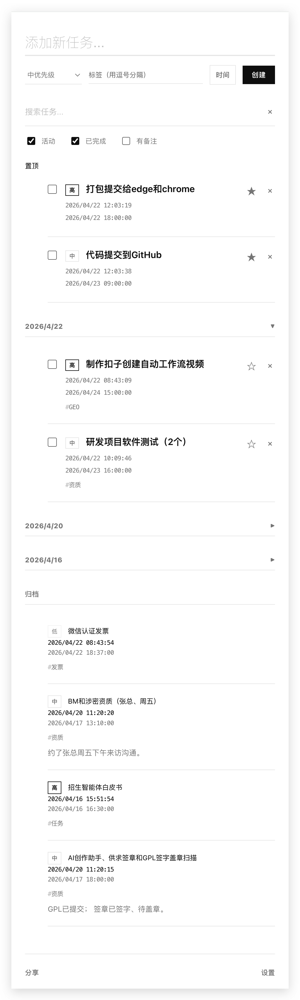
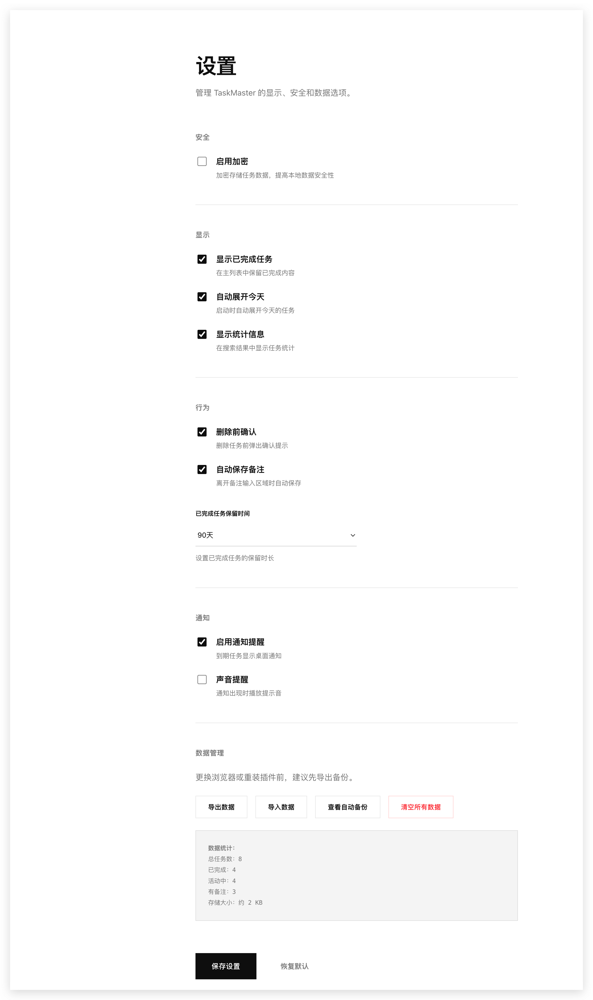
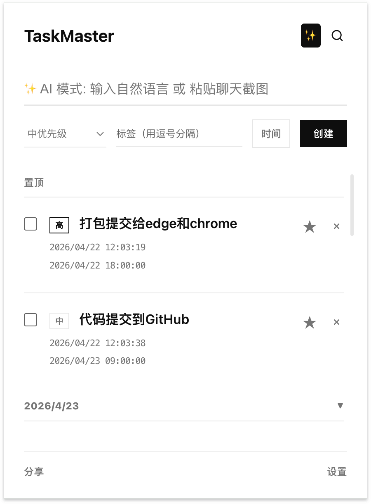
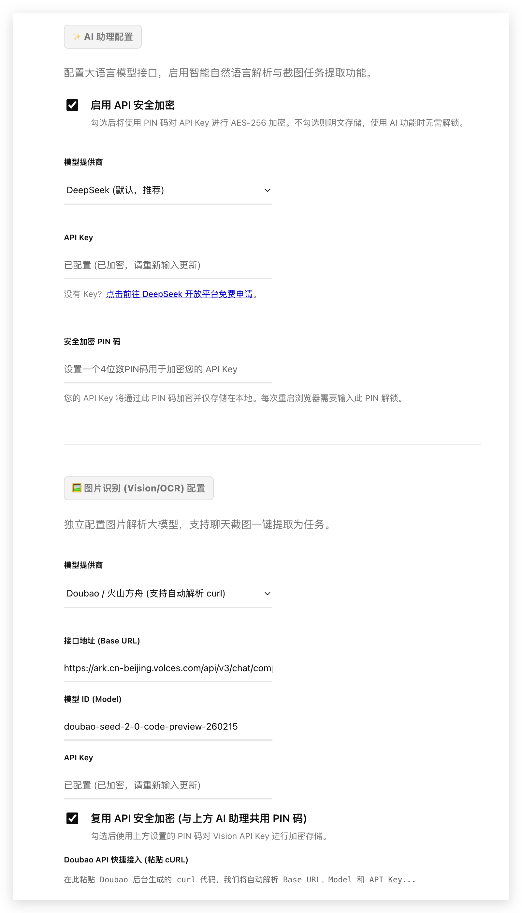

# TaskMaster - 极简高级智能待办事项管理扩展

<p align="center">
  
</p>

<p align="center">
  <a href="https://gitee.com/laifupan/TaskMaster/stargazers">
    
  </a>
  <a href="https://gitee.com/laifupan/TaskMaster/forks">
    
  </a>
  <a href="https://gitee.com/laifupan/TaskMaster/releases">
    
  </a>
</p>

TaskMaster 是一款基于现代极简设计美学构建的高级待办管理扩展，支持跨设备同步、本地安全加密与智能定时备份，让您的工作与生活井然有序。

## ✨ 功能特性 (v3.5.0)

| 功能 | 描述 |
|------|------|
| 🤖 **AI 智能自然语言解析** | 集成 DeepSeek/OpenAI，支持自然语言识别（如"明天下午三点开会"），一键自动填充任务要素 |
| 🛡️ **BYOK 银行级硬件加密** | AI 密钥本地存储，采用 Web Crypto API 的 AES-256-GCM 算法与用户自设 PIN 码深度加密，防 XSS 窃取 |
| 🎨 **现代极简设计美学** | 由留白、字重驱动的"高级排版设计"，结合流畅的阻尼微动效 |
| ⚡ **闪电般的任务录入** | 紧凑型悬浮时间选择器，支持快捷时间设定 |
| ☁️ **无缝跨设备同步** | 通过 Sync + Local 混合双驱存储架构，跨端漫游，突破配额限制 |
| 🕰️ **后台全自动静默备份** | Service Worker 后台自动生成每日快照（保留 7 天） |
| 🔐 **本地数据加密** | 支持任务内容 AES-256 加密 |
| 🔍 **高效检索与多维过滤** | 支持基于状态筛选，并能在搜索结果中高亮匹配关键词 |
| 📝 **任务备注功能** | 支持为任务添加详细备注说明 |
| 📌 **任务置顶与归档** | 支持任务置顶和归档管理 |

## 📱 界面预览

<p align="center">
  
  
</p>

<p align="center">
  
  
</p>

## 🚀 快速开始

### 安装说明

#### 开发者本地安装

```bash
# 克隆仓库
git clone https://gitee.com/laifupan/TaskMaster.git
# 或
git clone https://github.com/markdown777/TaskMaster.git
```

#### 浏览器加载扩展

1. 访问 `chrome://extensions/` (Chrome) 或 `edge://extensions/` (Edge)
2. 开启**开发者模式**
3. 点击**加载已解压的扩展程序**
4. 选择项目目录

## 📂 项目结构

```
TaskMaster/
├── adapters/                 # 适配器层
│   ├── crypto.js            # 加密适配器 (AES-256-GCM)
│   ├── network.js           # 网络适配器
│   └── storage.js           # 存储适配器
├── services/                # 服务层
│   └── ai.js                # AI 智能解析服务
├── docs/                    # 文档
│   └── superpowers/         # 高级功能文档
│       └── plans/           # 实现计划
├── icons/                   # 扩展图标
│   ├── icon16.png
│   ├── icon48.png
│   └── icon128.png
├── background.js            # Service Worker 后台脚本
├── constants.js             # 常量定义
├── manifest.json            # 扩展清单文件
├── options.html             # 设置页面 HTML
├── options.js               # 设置页面逻辑
├── popup.html               # 弹窗页面 HTML
├── popup.js                 # 弹窗页面逻辑
├── popup.css                # 弹窗样式
├── shareManager.js          # 分享管理模块
├── taskManager.js           # 任务管理核心模块
├── utils.js                 # 工具函数
└── test.js                  # 测试文件
```

## 🛠 技术架构

| 技术栈 | 说明 |
|--------|------|
| Chrome Extension Manifest V3 | 现代扩展架构 |
| Service Worker | 后台任务与自动备份 |
| 混合双驱存储引擎 | Sync + Local 跨端同步 |
| Web Crypto API | AES-256-GCM 银行级加密 |
| 原生 CSS3 | 阻尼动画与 DOM 优化 |
| AI 集成 | DeepSeek/OpenAI/豆包视觉模型 |

## 📖 使用指南

### 基本操作

1. **添加任务**: 在输入框中输入任务内容，按 Enter 或点击提交按钮
2. **完成任务**: 点击任务左侧的复选框
3. **删除任务**: 点击任务右侧的删除按钮
4. **任务置顶**: 点击图钉按钮置顶任务
5. **添加备注**: 点击任务上的备注图标添加详细说明

### AI 智能模式

1. 点击顶部 AI 按钮启用 AI 模式
2. 输入自然语言描述（如"明天下午三点开会"）
3. AI 自动解析并填充任务时间、优先级等信息
4. 支持图片粘贴识别（需配置视觉模型）

### 加密功能

1. 在设置页面启用加密功能
2. 设置 PIN 码保护您的任务数据
3. 支持任务内容加密和 AI 密钥保护

### 数据管理

- **导出数据**: 在设置页面导出所有任务
- **导入数据**: 支持 JSON 格式数据导入
- **自动备份**: Service Worker 每日自动备份（保留 7 天）

## 🔧 核心模块

### TaskManager (taskManager.js)

任务管理核心模块，提供任务的增删改查、排序、分组等功能。

```javascript
// 主要方法
- loadTasks()           // 加载任务
- addTask(taskData)     // 添加任务
- updateTask(id, updates) // 更新任务
- deleteTask(id)        // 删除任务
- toggleTaskComplete(id) // 切换完成状态
- toggleTaskPinned(id)  // 切换置顶
- searchTasks(query, filters) // 搜索任务
```

### AIService (services/ai.js)

AI 智能解析服务，支持自然语言和图片识别。

```javascript
// 主要方法
- parseTaskFromText(text, apiKey, provider, baseUrl, model) // 文本解析
- parseTaskFromImage(image, apiKey, provider, baseUrl, model) // 图片解析
```

### 适配器

| 适配器 | 功能 |
|--------|------|
| CryptoAdapter | AES-256-GCM 加密/解密 |
| NetworkAdapter | HTTP 请求封装 |
| StorageAdapter | Chrome Storage 封装 |

## 📝 版本历史

| 版本 | 更新内容 |
|------|----------|
| v3.5.0 | 引入 AI 大语言模型接口与自然语言智能建任务，BYOK 安全重构 |
| v3.0.0 | 架构重构与极简 UI 升级版 |
| v2.9.0 | 包含基础的任务提醒和管理功能 |

## 🤝 贡献指南

欢迎提交 Issue 和 Pull Request！

1. Fork 本仓库
2. 创建特性分支 (`git checkout -b feature/xxx`)
3. 提交更改 (`git commit -m 'Add xxx'`)
4. 推送分支 (`git push origin feature/xxx`)
5. 创建 Pull Request

## 📄 许可证

MIT License

---

<p align="center">Made with ❤️ by TaskMaster Team</p>